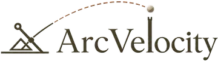
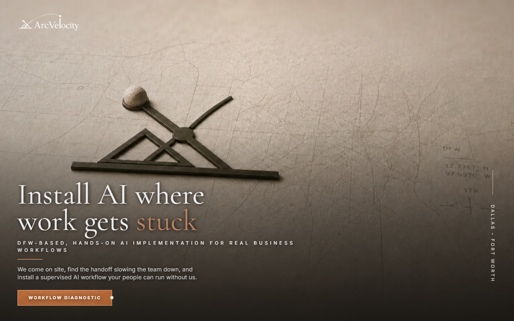
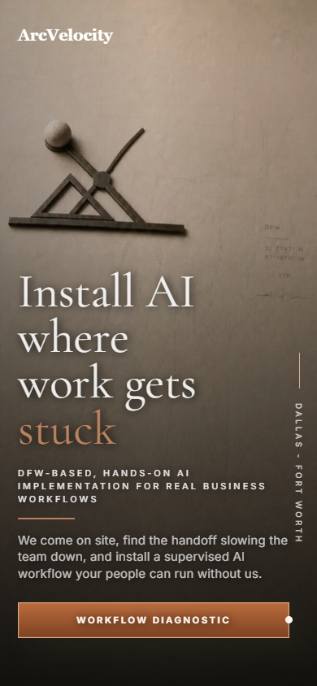

<p align="center">
  <a href="https://arcvelocity.com/">
    
  </a>
</p>

<h1 align="center">Install AI where work gets stuck.</h1>

<p align="center">
  ArcVelocity provides DFW-based, hands-on AI implementation for real business workflows.
</p>

<p align="center">
  <strong><a href="https://arcvelocity.com/">Explore the ArcVelocity website →</a></strong>
</p>

---

## Practical AI implementation starts with the workflow

ArcVelocity works with Dallas–Fort Worth businesses to identify handoffs, delays, approvals, and follow-up gaps inside real operations. The team then installs secure, supervised AI systems that fit existing tools and workflows.

The goal is practical operational improvement: fewer manual touchpoints, faster turnaround, clearer oversight, and systems the client team can run without depending on a permanent outside operator.

## Where ArcVelocity installs AI

| Workflow automation | Knowledge systems | AI copilots | Reporting and oversight |
| --- | --- | --- | --- |
| Intake and routing | SOP retrieval | Email triage | Operational dashboards |
| Task handoffs | Policy and document search | Drafts and responses | Approvals and audit trails |
| Automated follow-up | Version-aware answers | Summaries and next steps | Actionable operational insight |

## See the homepage

[](https://arcvelocity.com/)

<p align="center">
  <a href="https://arcvelocity.com/">
    
  </a>
</p>

The production website presents ArcVelocity's on-site implementation process, workflow-diagnostic approach, capabilities, engagement models, and DFW operating focus.

**[Visit arcvelocity.com](https://arcvelocity.com/)**

## About this public repository

This is a deliberately sanitized, static homepage demo for the ArcVelocity web experience. It contains only the client-side presentation code and approved media needed to render the homepage.

It is not the production source repository, does not serve production traffic, and cannot access ArcVelocity production systems. Navigation controls, social profiles, third-party accreditation links, production verification identifiers, and non-homepage routes are intentionally excluded.

### Public demo

- Static Next.js App Router homepage
- Responsive presentation components and page compositions
- ArcVelocity design foundations and approved brand assets
- Desktop and mobile captures of the sanitized homepage
- Automated publication-boundary and asset-integrity checks
- Clean Git history unrelated to the production repository

All committed media is recorded and integrity-locked in [`public/asset-manifest.json`](public/asset-manifest.json). See [TRADEMARKS.md](TRADEMARKS.md) for ownership notices and [PUBLIC-SCOPE.md](PUBLIC-SCOPE.md) for the publication boundary.

## Local development

Requirements: Node.js 20.9 or newer.

```bash
npm ci
npm run dev
```

Verify the static project with:

```bash
npm run safety
npm run lint
npm run build
npm audit --audit-level=high
```

Build output is written to `out/`. This repository is not configured for production deployment.

## Security and rights

Report suspected exposure privately according to [SECURITY.md](SECURITY.md). Do not open a public issue containing sensitive information.

The source is publicly viewable but is not offered under an open-source license. See [LICENSE.md](LICENSE.md).
